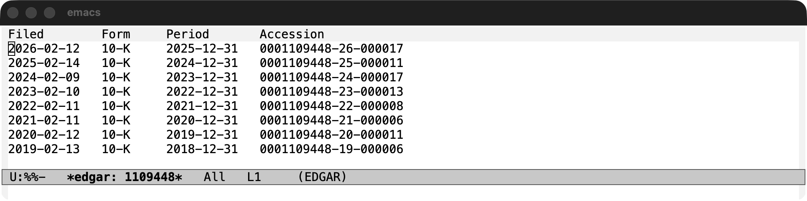
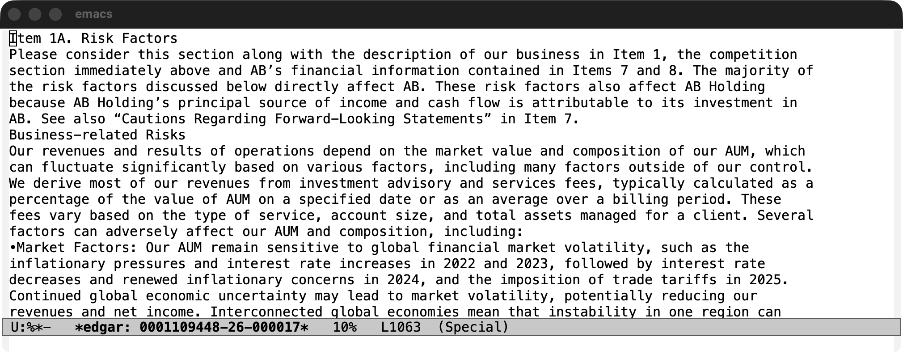
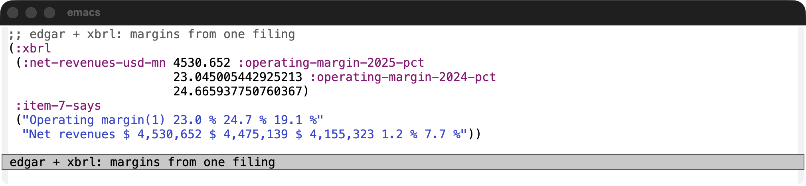
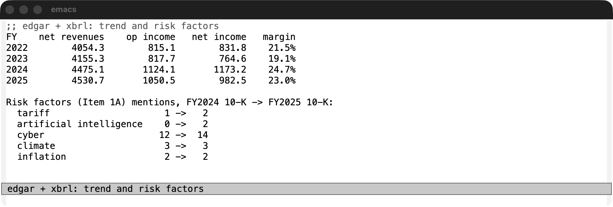
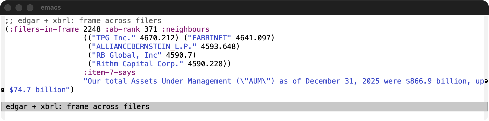

# Showcase: one annual report, two libraries

`edgar.el` knows what a filing *is*: which filings a company has, and the text of
each Item. [`xbrl.el`](https://github.com/davidawad/xbrl.el) knows what a filing
*states*: tagged numbers. Neither duplicates the other, so a question like "what
margin does management report, and what is it from the tagged numbers?" takes
both. These four examples answer such questions about **AllianceBernstein L.P.**
(CIK 1109448), using its Form 10-K for fiscal 2025 (filed 2026-02-12).

Which registrant: the ticker `AB` is **AllianceBernstein Holding L.P.** (CIK
825313), a separate registrant that files its own 10-K with nearly the same text.
Holding's only income is its stake in the operating partnership, and the SEC API
has no `Revenues` or `OperatingIncomeLoss` for it (404). **AllianceBernstein
L.P.** carries the operating numbers, and both libraries accept a numeric CIK, so
that is the one used here (it has no ticker, hence `1109448` below).

Every number and string on this page is real output from SEC responses
(fetched 2026-10-03). The same filing is recorded in `test/fixtures/10-k-ablp.*`,
and `test/edgar-showcase-test.el` asserts the margins and Item text offline
against real recorded SEC payloads (the fixture is the first 1.8 MB of the
filing, through Item 7, to keep the repository light; see
`test/fixtures/NOTES.md`). The examples below run against the full live filing.
Screenshots are a GUI Emacs window (Emacs 30.2, macOS) captured with
`screencapture`.

## Setup

```elisp
(setq xbrl-user-agent "Your Name you@example.com") ; SEC requires this
(defvar ab-cik 1109448) ; AllianceBernstein L.P., the operating partnership
(defvar ab (edgar-latest ab-cik "10-K"))
(defvar ab-sections (edgar-sections (edgar-text ab)))

(defun ab-year (concept year)
  "AB's 10-K value of us-gaap CONCEPT for the fiscal year ending in YEAR."
  (plist-get
   (seq-find (lambda (f) (string-prefix-p (format "%d" year) (plist-get f :end)))
             (xbrl-annual ab-cik concept))
   :val))

(defun ab-grep (key regexp)
  "First text matching REGEXP in section KEY, whitespace collapsed."
  (let ((body (cdr (assoc key ab-sections))))
    (when (string-match regexp body)
      (string-trim
       (replace-regexp-in-string "[ \t\n]+" " " (match-string 0 body))))))
```

`xbrl-annual` returns the latest-filed 10-K value per fiscal year from the SEC
companyconcept API, so `ab-year` is one call per concept.

## 1. List the annual filings, then look at their Items

`M-x edgar-list`, answering `1109448` and `10-K`, browses the filings (RET opens
one):



```elisp
(list
 (mapcar (lambda (f) (list (plist-get f :filed) (plist-get f :report) (plist-get f :accn)))
         (seq-take (edgar-filings ab-cik "10-K") 3))
 (mapcar (lambda (s) (cons (car s) (length (cdr s)))) ab-sections))
```

```elisp
((("2026-02-12" "2025-12-31" "0001109448-26-000017")
  ("2025-02-14" "2024-12-31" "0001109448-25-000011")
  ("2024-02-09" "2023-12-31" "0001109448-24-000017"))
 (("I.1" . 50325) ("I.1A" . 46901) ("I.1B" . 122) ("I.1C" . 5587)
  ("I.2" . 1361) ("I.3" . 1250) ("I.4" . 203) ("II.5" . 5082)
  ("II.6" . 24) ("II.7" . 99100) ("II.7A" . 3823) ("II.8" . 197347)
  ("II.9" . 208) ("II.9A" . 4241) ("II.9B" . 680) ("II.9C" . 249)
  ("III.10" . 46434) ("III.11" . 103053) ("III.12" . 15881)
  ("III.13" . 5103) ("III.14" . 1910) ("IV.15" . 11404)
  ("IV.16" . 2830)))
```

Item keys are Part-qualified (`II.7` is Item 7). `M-x edgar-read` (or
`edgar-open`) shows the rendered report; this is Item 1A, Risk Factors:



## 2. Management's margin next to the margin from tagged numbers

Item 7 prints an operating margin ("operating income excluding net income
attributable to non-controlling interests, as a percentage of net revenues").
The same figure from `xbrl.el` facts, next to the text:

```elisp
(defun ab-operating-margin (year)
  "Operating income less the part owed to non-controlling interests, over net revenues."
  (* 100 (/ (float (- (ab-year "OperatingIncomeLoss" year)
                      (ab-year "NetIncomeLossAttributableToNoncontrollingInterest" year)))
            (ab-year "RevenuesNetOfInterestExpense" year))))

(list :xbrl (list :net-revenues-usd-mn (/ (ab-year "RevenuesNetOfInterestExpense" 2025) 1e6)
                  :operating-margin-2025-pct (ab-operating-margin 2025)
                  :operating-margin-2024-pct (ab-operating-margin 2024))
      :item-7-says (list (ab-grep "II.7" "^Operating margin(1) .*$")
                         (ab-grep "II.7" "^Net revenues .*$")))
```

```elisp
(:xbrl
 (:net-revenues-usd-mn 4530.652 :operating-margin-2025-pct
                       23.045005442925213 :operating-margin-2024-pct
                       24.665937750760367)
 :item-7-says
 ("Operating margin(1) 23.0 % 24.7 % 19.1 %"
  "Net revenues $ 4,530,652 $ 4,475,139 $ 4,155,323 1.2 % 7.7 %"))
```

The facts give 23.05% and 24.67%, which Item 7 prints as 23.0% and 24.7%.



## 3. Trend from the API, plus how the risk factors changed

Four years of tagged facts, then a word count over Item 1A of this filing and of
the previous one (`edgar-section` takes the bare `"1A"`). This uses
`ab-operating-margin` from example 2.

```elisp
(defun ab-count (regexp text)
  (with-temp-buffer
    (insert text)
    (goto-char (point-min))
    (let ((n 0)) (while (re-search-forward regexp nil t) (cl-incf n)) n)))

(let ((risk-prev (edgar-section (nth 1 (edgar-filings ab-cik "10-K")) "1A"))
      (risk-now (cdr (assoc "I.1A" ab-sections))))
  (concat
   (format "%-5s %12s %12s %12s %8s\n" "FY" "net revenues" "op income" "net income" "margin")
   (mapconcat
    (lambda (year)
      (let ((rev (ab-year "RevenuesNetOfInterestExpense" year))
            (op (ab-year "OperatingIncomeLoss" year))
            (ni (ab-year "NetIncomeLoss" year)))
        (format "%-5d %12.1f %12.1f %12.1f %7.1f%%" year (/ rev 1e6) (/ op 1e6) (/ ni 1e6)
                (ab-operating-margin year))))
    '(2022 2023 2024 2025) "\n")
   "\n\nRisk factors (Item 1A) mentions, FY2024 10-K -> FY2025 10-K:\n"
   (mapconcat
    (lambda (term)
      (format "  %-24s %3d -> %3d" term (ab-count term risk-prev) (ab-count term risk-now)))
    '("tariff" "artificial intelligence" "cyber" "climate" "inflation") "\n")))
```

```
FY    net revenues    op income   net income   margin
2022        4054.3        815.1        831.8    21.5%
2023        4155.3        817.7        764.6    19.1%
2024        4475.1       1124.1       1173.2    24.7%
2025        4530.7       1050.5        982.5    23.0%

Risk factors (Item 1A) mentions, FY2024 10-K -> FY2025 10-K:
  tariff                     1 ->   2
  artificial intelligence    0 ->   2
  cyber                     12 ->  14
  climate                    3 ->   3
  inflation                  2 ->   2
```



## 4. A frame across filers, next to a section

`xbrl-frame` returns one concept for every filer. AB's 2025 `Revenues` (gross,
before interest expense, so a little above the net revenues in example 2) is
ranked in the `us-gaap` frame for calendar 2025 and shown with its neighbours,
next to Item 7's own assets-under-management sentence:

```elisp
(let* ((frame (sort (copy-sequence (xbrl-frame "us-gaap" "Revenues" "USD" "CY2025"))
                    (lambda (a b) (> (plist-get a :val) (plist-get b :val)))))
       (rank (1+ (seq-position frame (ab-year "Revenues" 2025)
                               (lambda (r v) (= (plist-get r :val) v))))))
  (list :filers-in-frame (length frame)
        :ab-rank rank
        :neighbours (mapcar (lambda (r) (list (plist-get r :entityName) (/ (plist-get r :val) 1e6)))
                            (seq-subseq frame (- rank 3) (+ rank 2)))
        :item-7-says (ab-grep "II.7" "Our total Assets Under Management\\(?:.\\|\n\\)*?billion, up \\$[0-9.]+\\(?:.\\|\n\\)*?billion")))
```

```elisp
(:filers-in-frame 2248 :ab-rank 371 :neighbours
                  (("TPG Inc." 4670.212) ("FABRINET" 4641.097)
                   ("ALLIANCEBERNSTEIN L.P." 4593.648)
                   ("RB Global, Inc" 4590.7)
                   ("Rithm Capital Corp." 4590.228))
                  :item-7-says
                  "Our total Assets Under Management (\"AUM\") as of December 31, 2025 were $866.9 billion, up $74.7 billion")
```



## 5. Who holds a security, and what a manager holds

This one leaves AllianceBernstein for every 13F filer at once. `edgar-13f-dataset`
reads the SEC's quarterly [Form 13F data
sets](https://www.sec.gov/data-research/sec-markets-data/form-13f-data-sets)
(the newest two are ZIPs of about 100 MB each, with 6.7 million information-table rows between them).
It builds an index once, in a batch Emacs subprocess, and caches it on disk:

```elisp
(edgar-13f-index-async
 (lambda (index err)
   (message "13F index: %s vs %s" (plist-get index :period) (plist-get index :prior-period))))
```

The figures below are from the data sets for filings made 2026-06-01 to 2026-08-31
and 2026-03-01 to 2026-05-31 (run 2026-11-09). That gives period 2026-06-30
against 2026-03-31, with 8,857 managers filing for the current quarter.

```elisp
(mapcar (lambda (row) (list (plist-get row :issuer) (plist-get row :holders)
                            (plist-get row :prior-holders)))
        (plist-get (edgar-13f-securities :top 5) :rows))
```

```elisp
(("MICROSOFT CORP" 6216 6220) ("AMAZON COM INC" 6131 6022)
 ("APPLE INC" 6116 6117) ("NVIDIA CORPORATION" 5962 5869)
 ("ALPHABET INC" 5784 5656))
```

Each count is the number of distinct filer CIKs holding shares, leaving out put
and call rows. `edgar-13f-holders` lists those filers, each with this quarter's
and last quarter's position and a status. `exited` means the filer filed for
this quarter without the position; `not-reported` means it has not filed for
this quarter at all:

```elisp
(let ((nvda (edgar-13f-holders "67066G104")))
  (list :holders (plist-get nvda :holders) :counts (plist-get nvda :counts)
        :option-rows (length (plist-get nvda :options))
        :largest (seq-take (mapcar (lambda (row) (plist-get row :name))
                                   (plist-get nvda :rows))
                           1)))
```

```elisp
(:holders 5962 :counts (:new 303 :added 2991 :reduced 2347 :unchanged 321
                        :exited 117 :not-reported 93)
 :option-rows 574 :largest ("BlackRock, Inc."))
```

Going the other way, `edgar-13f-filers` searches filer names and
`edgar-13f-portfolio` gives one manager's positions. Its status counts reconcile
with both quarters: 214 + 400 + 377 + 6 = 997 current positions, and
400 + 377 + 6 + 210 + 0 = 993 prior ones (exited plus not-reported).

```elisp
(let ((bw (edgar-13f-portfolio
           (plist-get (car (edgar-13f-filers "bridgewater")) :cik))))
  (list (plist-get bw :name) (plist-get bw :accession)
        (plist-get bw :current-positions) (plist-get bw :prior-positions)
        (plist-get bw :counts)))
```

```elisp
("Bridgewater Associates, LP" "0001350694-26-000003" 997 993
 (:new 214 :added 400 :reduced 377 :unchanged 6 :exited 210 :not-reported 0))
```

`:filing` is a filing plist, so `(edgar-13f-holdings (plist-get bw :filing))`
reads the same filing's XML information table.

Values need care. Since 2023 filers report dollars, but 339 managers in this
quarter still report thousands. T. Rowe Price Associates, for example, reports
$74.0 million for 369.8 million NVIDIA shares. Such a filer and its
positions are marked `:value-suspect`. `:value-usd` keeps the filed number and
`:value-usd-adjusted` multiplies it by 1000. A security total carries
`:value-suspect-usd`, the filed value from suspect filers, and is flagged only
when rescaling them moves the total by more than 1%. For NVIDIA that is
$144.5 million filed, which becomes 4.3% of the $3.36 trillion adjusted total.
At this threshold all of the 100 most widely held securities are still flagged,
because T. Rowe Price alone moves 56 of them by more than 1%. At 5% it would be
29 of them.

## 6. Which funds hold a bond, and what a fund holds

13F covers managers and US-listed equities. `edgar-nport-dataset` covers
registered funds (mutual funds, ETFs, closed-end funds; not money market funds,
which file Form N-MFP) and every asset class they report: bonds, munis, loans,
asset-backed securities and derivatives as well as stocks. It reads the SEC's
quarterly [Form N-PORT data
sets](https://www.sec.gov/data-research/sec-markets-data/form-n-port-data-sets)
(about 450 MB zipped each, 1.6 GB of tables unzipped) and builds its index the
same way, in a batch Emacs subprocess:

```elisp
(edgar-nport-index-async
 (lambda (index err)
   (message "N-PORT index: %s vs %s" (plist-get index :period) (plist-get index :prior-period))))
```

Funds report every month, but only the last month of each fiscal quarter is
made public, so the data set filed July to September 2026 holds reports dated
May, June and July. The current period is the most common report date
(2026-06-30); each fund's current report is its latest one dated May through
July, and its prior report the one three months before that. The figures below
are from the 2026 Q3 and Q2 data sets (run 2026-11-09): 14,116 funds, 9.7
million holding rows and 1.2 million distinct securities.

Apple's most widely held bond, and who holds it:

```elisp
(mapcar (lambda (row) (list (plist-get row :cusip) (plist-get row :title)
                            (plist-get row :funds) (plist-get row :prior-funds)))
        (plist-get (edgar-nport-securities :query "APPLE INC" :asset-category "DBT" :top 3) :rows))
```

```elisp
(("037833AL4" "AAPL 3.85 05/04/43" 84 78)
 ("037833EF3" "Apple, Inc. 2.65%, Due 02/08/2051" 80 80)
 ("037833EE6" "Apple Inc" 76 64))
```

```elisp
(let ((note (edgar-nport-holders "037833AL4")))
  (list :funds (plist-get note :funds) :counts (plist-get note :counts)
        :largest (mapcar (lambda (row) (list (plist-get row :fund-name) (plist-get row :balance)
                                             (plist-get row :units) (plist-get row :status)))
                         (seq-take (plist-get note :rows) 2))))
```

```elisp
(:funds 84 :counts (:new 7 :added 16 :reduced 13 :unchanged 48 :exited 0 :not-reported 1)
 :largest (("VANGUARD WELLINGTON FUND" 48000000 "PA" unchanged)
           ("VANGUARD TOTAL BOND MARKET II INDEX FUND" 34463000 "PA" unchanged)))
```

`:units` `"PA"` means the balance is principal; shares are `"NS"` and
contracts `"NC"`. `:issuer-category` filters by issuer type, so the most widely
held municipal bonds are one call away. `holders` accepts a CUSIP, an ISIN or a
ticker from the data set's IDENTIFIERS table:

```elisp
(mapcar (lambda (row) (list (plist-get row :cusip) (plist-get row :issuer) (plist-get row :funds)))
        (plist-get (edgar-nport-securities :issuer-category "MUN" :top 2) :rows))
```

```elisp
(("74529JPX7" "Puerto Rico Sales Tax Financing Corp Sales Tax Revenue" 265)
 ("74529JQG3" "Puerto Rico Sales Tax Financing Corp Sales Tax Revenue" 199))
```

```elisp
(let ((nvda (edgar-nport-holders "NVDA")))
  (list (plist-get nvda :cusip) (plist-get nvda :funds) (plist-get nvda :counts)))
```

```elisp
("67066G104" 2363 (:new 186 :added 845 :reduced 1092 :unchanged 240 :exited 27 :not-reported 27))
```

Going the other way, `edgar-nport-funds` searches series and registrant names
and `edgar-nport-portfolio` takes a series id. Its counts reconcile as in 13F:
138 + 1460 + 1334 + 613 = 3545 current holdings, and 1460 + 1334 + 613 + 116 +
0 = 3523 prior ones.

```elisp
(let ((vtsm (edgar-nport-portfolio
             (plist-get (car (edgar-nport-funds "total stock market index")) :series-id))))
  (list (plist-get vtsm :fund-name) (plist-get vtsm :series-id) (plist-get vtsm :report-date)
        (plist-get vtsm :holdings) (plist-get vtsm :prior-holdings) (plist-get vtsm :counts)
        (plist-get vtsm :accession)))
```

```elisp
("VANGUARD TOTAL STOCK MARKET INDEX FUND" "S000002848" "2026-06-30" 3545 3523
 (:new 138 :added 1460 :reduced 1334 :unchanged 613 :exited 116 :not-reported 0)
 "0000036405-26-000480")
```

`:filing` is a filing plist for the same report, so `(edgar-fund-report
(plist-get vtsm :filing))` reads its N-PORT XML; for a small fund (Catholic
Responsible Investments Ultra Short Bond Fund) that gave the same 156 holdings
as the index.

## Limits seen while writing this

- The frame mixes every kind of filer and fiscal year end; neighbours by revenue
  are not peers. Large asset managers (BlackRock, T. Rowe Price) were not in
  the `Revenues` frame (I did not investigate why).
- `ticker` arguments resolve through the SEC ticker file, which lists only
  Holding under `AB`; the operating partnership needs its CIK.
- Item bodies are rendered HTML, running text and page numbers included, not
  cleaned prose.
- A cold 13F build took about 90 s of CPU time but 14 minutes of wall time on a
  laptop at load average 50. It runs in a subprocess (the calling Emacs stayed
  responsive), and later queries take 0.02 to 0.6 s.
- A cold N-PORT build (both data sets downloaded, 9.7 million rows) took 241 s
  of CPU time and 304 s of wall time, peaking at 6.6 GB of memory in the
  subprocess; the calling Emacs kept running its event loop throughout. Loading
  the cached index took 2.5 s (0.3 s of CPU) and each query above took under
  0.1 s.
- N-PORT has no issuer-level grouping: each bond issue is its own CUSIP, and
  holdings with neither CUSIP nor ISIN (forwards, swaps, many loans) are
  grouped by issuer name plus title as filed, so differently worded titles are
  different securities. 1,624 holding rows were in a foreign currency without an
  exchange rate and are marked `:value-unconverted`.
